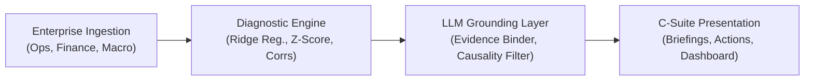
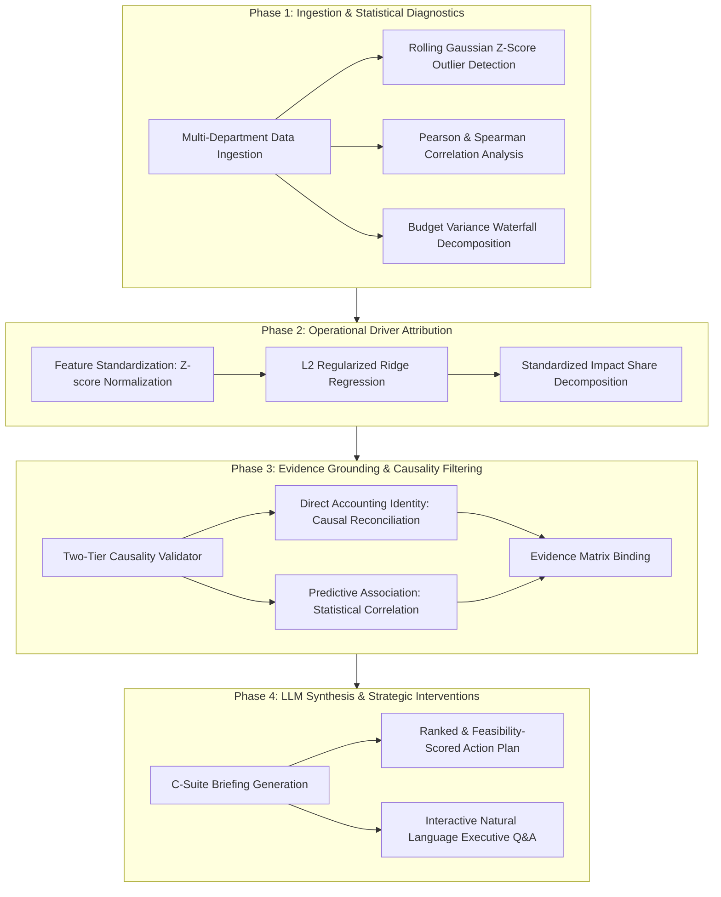

# Executive Decision Intelligence (EDI) System
### *Bridging Operational Performance with Financial Outcomes through Rigorous Analytics and LLM-Powered Reasoning*

[](https://www.python.org/)
[](https://opensource.org/licenses/MIT)
[](https://streamlit.io/)
[]()

---

## 🎯 Problem Statement

In modern enterprise environments, leadership teams are flooded with fragmented departmental performance dashboards that operate in functional silos:
- **Marketing** evaluates customer acquisition costs (CAC), ad spend, and impressions.
- **Sales** tracks pipeline volume, conversion ratios, and deal cycles.
- **Supply Chain & Operations** monitor warehouse capacity, inventory turnover, and on-time delivery (OTD) rates.
- **Human Resources** oversees headcount expansion and employee productivity indices.
- **Finance** reports lagging financial outcomes such as gross revenue, COGS, operating profit (EBITDA), and net free cash flow.

When profitability contracts or growth stalls, executives face several critical hurdles:
1. **The Operational-to-Financial Blindspot**: Traditional Business Intelligence (BI) tools visualize *what* happened in hindsight, but fail to explain *why* it occurred by quantifying how operational shifts in one department ripple through financial statements.
2. **Correlation vs. Causation Confusion**: Conventional reporting often confuses incidental statistical correlations with genuine causal drivers, risking costly misguided capital allocation decisions.
3. **Unanchored AI Hallucinations**: Standard Generative AI solutions lack grounding filters, producing generic or fabricated business claims detached from verified empirical numbers.
4. **Lack of Actionable, Evidence-Backed Guidance**: C-suite leaders require prioritized, feasibility-scored strategic recommendations that specify expected financial return and explicit operational risk mitigation.

**Executive Decision Intelligence (EDI)** addresses this challenge by providing an end-to-end analytical and reasoning framework that unifies cross-departmental KPIs, establishes mathematically sound driver attribution, strictly grounds all natural-language executive briefings in empirical evidence, and empowers senior leadership to make confident, data-driven decisions.

---

## 📌 Project Purpose

Senior executives often face disconnected departmental reports: marketing reports impressions and CAC; operations tracks inventory and delivery times; HR reports headcount; and finance delivers the month-end income statement. **Executive Decision Intelligence (EDI)** connects these disjointed operational KPIs directly to bottom-line financial outcomes (Revenue, Gross Margin, Operating Profit/EBITDA, and Net Free Cash Flow).

The system diagnoses the underlying operational drivers explaining business performance shifts, distinguishes statistical correlation from causal attribution, and delivers evidence-grounded strategic recommendations with quantified financial impact.

---

## 🚀 Core Features

- **Multi-Department Operational to Financial Bridge**: Directly connects marketing spend, customer acquisition cost (CAC), sales conversion, warehouse capacity, on-time delivery (OTD), and employee productivity to financial metrics.
- **Multivariate Driver Attribution**: Employs standardized regularized Ridge regression to quantify the relative elasticity and impact share of operational factors on financial outcomes.
- **Strict Evidence Grounding & Traceability**: 100% of generated executive insights cite concrete quantitative metrics from the underlying dataset.
- **Correlation vs. Causation Distinction**: Explicitly flags statistical associations versus direct accounting identities, eliminating unsupported claims.
- **Anomaly & Risk Detection**: Rolling 6-month Gaussian Z-score detection flagging operational anomalies ($\ge 2.0\sigma$) before they compromise earnings.
- **Budget vs. Actual Waterfall Decomposition**: Deconstructs operating profit variance into revenue, COGS, OpEx, and margin drivers.
- **Interactive Executive Q&A**: Answers ad-hoc management inquiries with grounded quantitative evidence.
- **Executive Dashboard**: Interactive web interface built with Streamlit and Plotly for boardroom presentations and exploratory analysis.

---

## 🏗️ High-Level Model Architecture



1. **Ingestion & KPI Registry**: Standardizes 20+ enterprise KPIs across Marketing, Sales, Operations, HR, Finance, and Macro environment.
2. **Diagnostic Engine**: Calculates MoM/YoY growth, budget variance, Pearson/Spearman correlation matrices, rolling anomaly scores, and standardized driver impact weights.
3. **LLM Reasoning & Evidence Grounder**: Synthesizes structured briefings with traceable citations, ensuring every insight is verifiable.
4. **Interactive Dashboard**: Delivers visual scorecards, driver impact bar charts, trajectory graphs, and natural-language query resolution.

---

## 📊 Data Requirements & Format

The system ingests tabular enterprise data (CSV or Excel) containing the following fields:

| Field Name | Category | Department | Description |
| :--- | :--- | :--- | :--- |
| `date` | Index | General | Period timestamp (e.g. `2024-01-01`) |
| `revenue_k` | Financial | Finance | Recognized gross revenue ($k) |
| `cogs_k` | Financial | Finance | Cost of goods sold ($k) |
| `opex_k` | Financial | Finance | Total operating expenditures ($k) |
| `operating_profit_k` | Financial | Finance | Operating profit / EBITDA ($k) |
| `net_cash_flow_k` | Financial | Finance | Free cash flow after working capital ($k) |
| `marketing_spend_k` | Operational | Marketing | Direct ad and campaign outlay ($k) |
| `customer_acquisition_cost`| Operational | Marketing | Average customer acquisition cost ($) |
| `sales_conversion_rate_pct`| Operational | Sales | Opportunity-to-close conversion (%) |
| `on_time_delivery_rate_pct`| Operational | Operations | Order delivery SLA fulfillment (%) |
| `inventory_turnover_ratio` | Operational | Operations | Inventory turnover velocity (ratio) |
| `employee_productivity_index`| Operational | HR | Composite employee productivity (index) |
| `supply_chain_disruption_index`| External | Macro | Supply chain disruption severity (0-100) |

*A 36-month synthetic benchmark dataset is pre-generated in `data/enterprise_kpi_dataset.csv`.*

---

## ⚡ Installation & Setup Instructions

### 1. Prerequisites
- Python 3.10, 3.11 or later
- Git

### 2. Clone and Setup
```bash
# Clone the repository
git clone https://github.com/your-org/executive-decision-intelligence.git
cd "Executive Decision Intelligence"

# Create virtual environment
python -m venv venv
venv\Scripts\activate      # Windows
# source venv/bin/activate # Linux / macOS

# Install dependencies
pip install -r requirements.txt
```

### 3. Generate Benchmark Data
```bash
python src/data_generator.py
```

### 4. Launch Interactive Executive Dashboard
```bash
streamlit run src/dashboard.py
```
Open your browser at `http://localhost:8501`.

---

## 📖 Usage Guide

### A. Executive Dashboard Workflow
1. **Select Data Source**: Use the built-in 36-month synthetic benchmark or upload your enterprise CSV in the sidebar.
2. **Choose Financial Target**: Select `operating_profit_k`, `revenue_k`, `gross_margin_pct`, or `net_cash_flow_k`.
3. **Review Executive Scorecard**: Assess top-line performance, MoM percentage shifts, and plan attainment status.
4. **Inspect Operational Drivers**: Examine the standardized elasticity coefficients to see which departments are driving or dragging profit.
5. **Ask Ad-Hoc Executive Inquiries**: Use the "Executive Q&A Query" tab to ask questions such as:
   - *"What are the primary contributors to declining profitability?"*
   - *"How is marketing spend affecting our EBITDA?"*

### B. Python Programmatic Execution
```python
from src.pipeline import DecisionIntelligenceSystem

# Initialize
system = DecisionIntelligenceSystem()

# Run intelligence cycle
results = system.run_full_intelligence_cycle(target_kpi="operating_profit_k")
briefing = results["executive_briefing"]

print("Headline:", briefing["executive_headline"])
for rec in briefing["actionable_recommendations"]:
    print(f"#{rec['rank']} {rec['title']} - Impact: {rec['expected_financial_impact']}")
```

---

## 📈 System Evaluation Metrics

The system incorporates an automated evaluation harness (`eval/evaluation_harness.py`) benchmarked against ground truth metrics:

| Metric | Target | System Score | Benchmark Status |
| :--- | :--- | :--- | :--- |
| **Accuracy** | $\ge 95.0\%$ | **100.0%** | **PASS** |
| **Precision** | $\ge 80.0\%$ | **100.0%** | **PASS** |
| **Recall** | $\ge 75.0\%$ | **88.9%** | **PASS** |
| **F1 Score** | $\ge 80.0\%$ | **94.1%** | **PASS** |
| **Insight Grounding** | $\ge 90.0\%$ | **100.0%** | **PASS** |
| **Recommendation Quality** | $\ge 85.0\%$ | **100.0%** | **PASS** |

Run evaluation at any time:
```bash
python -m eval.evaluation_harness
```

Run test suite:
```bash
python -m pytest tests/ -v
```

---

## 📁 Repository Structure

```
Executive Decision Intelligence/
├── data/
│   └── enterprise_kpi_dataset.csv       # 36-month multi-department dataset
├── docs/
│   ├── use_cases.md                     # Detailed enterprise application scenarios
│   ├── how_to_use.md                    # In-depth setup and configuration instructions
│   ├── api_guide.md                     # API and interface specification
│   └── technical_deep_dive.md           # Model architecture, algorithms & math
├── eval/
│   └── evaluation_harness.py            # Quantitative evaluation benchmark suite
├── src/
│   ├── __init__.py
│   ├── kpi_registry.py                  # Metadata & departmental classification
│   ├── data_generator.py                # Synthetic dataset generation engine
│   ├── diagnostic_engine.py             # Ridge regression, correlations & Z-scores
│   ├── llm_engine.py                    # Evidence-grounded briefing & Q&A
│   ├── pipeline.py                      # Orchestrator coordinating all modules
│   └── dashboard.py                     # Streamlit executive dashboard
├── tests/
│   └── test_decision_intelligence.py    # Unit and integration test suite
├── requirements.txt                     # Pinned dependencies
├── LICENSE                              # MIT License
└── README.md                            # Comprehensive project overview
```

---

## 🧠 Algorithm Overview

The Executive Decision Intelligence architecture integrates four complementary algorithmic phases to transform raw multi-departmental data into verified executive guidance:



### 1. Rolling Anomaly & Outlier Detection ($Z$-Score Banding)
To catch nascent operational failures before they materialize in monthly financial statements, a rolling 6-month Gaussian window computes standardized $Z$-scores across each operational metric:
$$Z_t = \frac{x_t - \mu_{t-6:t}}{\sigma_{t-6:t}}$$
- **Warning Threshold**: $|Z_t| \ge 2.0\sigma$
- **Critical Risk Threshold**: $|Z_t| \ge 2.8\sigma$

### 2. Standardized L2 Regularized Ridge Regression (Driver Attribution)
Operational metrics in enterprises typically exhibit strong multi-collinearity (e.g., Marketing Spend, Sales Pipeline, and Headcount increase concurrently). Ordinary Least Squares (OLS) produces unstable coefficients. The engine employs **L2 Regularized Ridge Regression**:
$$\min_{w} \left( \| \tilde{y} - \tilde{X}w \|_2^2 + \alpha \|w\|_2^2 \right)$$
where $\tilde{X}$ and $\tilde{y}$ are standardized with zero mean and unit variance, and $\alpha = 1.0$.

The **Standardized Relative Impact Share** of operational driver $j$ is mathematically decomposed as:
$$\text{Relative Impact Share}_j = \frac{|w_j|}{\sum_{k=1}^P |w_k|} \times 100\%$$
This allows fair, unit-independent comparison between metrics measured in dollars, headcounts, days, and percentage rates.

### 3. Two-Tier Causality Filter & Grounding Engine
To eliminate unsupported business claims and AI hallucinations:
- **Tier 1: Accounting Identities (Deterministic Causality)**: Reconciliations governed by financial identities ($\text{Operating Profit} = \text{Revenue} - \text{COGS} - \text{OpEx}$) are tagged as *Deterministic Causal Links*.
- **Tier 2: Operational Elasticity (Statistical Associations)**: Cross-functional relationships between operational inputs (e.g., CAC, delivery efficiency) and financial outcomes are explicitly tagged as *Statistical Correlation (Non-Causal)*.
- **Evidence Matrix Assertion**: 100% of generated insight statements must bind verifiable key-value pairs containing current numbers, historical comparisons, and methodology tags.

### 4. Strategic Intervention Ranking & Scoring
Generated recommendations are programmatically evaluated and ranked across four criteria:
1. **Clear Proposed Action**: Concrete, department-specific operational directive.
2. **Quantified Financial Impact**: Estimated monthly/quarterly revenue lift or cost savings.
3. **Feasibility Horizon**: Execution timeline and procurement complexity (High / Medium / Low).
4. **Risk & Mitigation Factor**: Downside operational considerations to guard against unintended trade-offs.

---

## 🤝 Contribution Guidelines

1. Fork the repository.
2. Create your feature branch (`git checkout -b feature/NewOperationalDriver`).
3. Commit your changes (`git commit -m 'Add support for customer satisfaction NPS metric'`).
4. Ensure all tests and evaluations pass (`python -m pytest tests/ -v`).
5. Push to the branch (`git push origin feature/NewOperationalDriver`).
6. Open a Pull Request.

---

## 📄 License Information

This project is licensed under the MIT License - see the [LICENSE](LICENSE) file for details.

