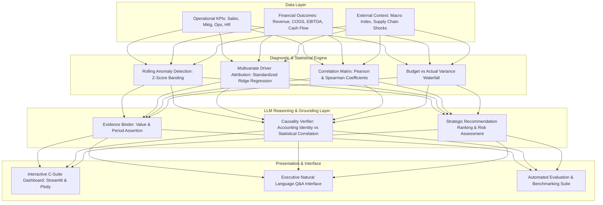

# Technical Deep Dive: Architecture, Mathematical Modeling, & LLM Grounding

This document delivers an in-depth technical explanation of the Executive Decision Intelligence (EDI) platform, covering mathematical methodologies, model architectures, LLM reasoning integration, and causality distinction frameworks.

---

## 1. System Architecture Overview

---

## 2. Mathematical Modeling & Driver Attribution

### A. Standardized Ridge Regression for Operational Elasticity
In enterprise environments, operational KPIs frequently exhibit multi-collinearity (e.g., Marketing Spend and Sales Pipeline are strongly correlated). Ordinary Least Squares (OLS) can produce unstable, oscillating coefficients. To overcome this, the Diagnostic Engine uses **L2 Regularized Ridge Regression**:

$$\min_{w} \left( \| y - Xw \|_2^2 + \alpha \|w\|_2^2 \right)$$

where:
- $X$ is the standardized feature matrix of operational metrics:
  $$\tilde{x}_{ij} = \frac{x_{ij} - \mu_j}{\sigma_j}$$
- $y$ is the standardized financial target (e.g., Operating Profit / EBITDA):
  $$\tilde{y}_i = \frac{y_i - \mu_y}{\sigma_y}$$
- $\alpha = 1.0$ controls the regularizing penalty shrinkage parameter.

**Standardized Driver Impact Share:**
Each operational driver's relative contribution to the financial target is decomposed as:
$$\text{Relative Impact Share}_j = \frac{|w_j|}{\sum_{k=1}^P |w_k|} \times 100\%$$

This formulation yields comparable impact weights across metrics measured in disparate units (e.g., dollars, headcount, percentages, or turnaround ratios).

### B. Statistical Outlier & Anomaly Detection
To isolate sudden operational breakdowns before they manifest in quarterly financial disclosures, a rolling Gaussian window is applied across monthly intervals:

$$Z_t = \frac{x_t - \mu_{t-6:t}}{\sigma_{t-6:t}}$$

- **Warning Threshold**: $|Z_t| \ge 2.0\sigma$
- **Critical Risk Threshold**: $|Z_t| \ge 2.8\sigma$

---

## 3. The Evidence Grounding & Causality Distinction Framework

A major vulnerability of enterprise generative AI is the tendency to confuse correlation with causation, or to invent unsubstantiated business claims. 

The EDI system implements a **Two-Tier Grounding Filter**:
1. **Accounting Identities (Direct Causal Links)**:
   - Relationships governed by arithmetic accounting identities (e.g., $\text{Operating Profit} = \text{Revenue} - \text{COGS} - \text{OpEx}$) are explicitly tagged as **Direct Causal Reconciliations**.
2. **Operational Associations (Statistical Correlations)**:
   - Relationships between operational inputs (e.g., employee productivity index, customer acquisition cost) and top-line outcomes are explicitly tagged as **Statistical Correlation (Non-Causal)**. The system notes that these represent predictive associations rather than randomized causal experiments.
3. **Traceable Citations**:
   - Every generated insight must contain an `evidence` object binding observed numerical values directly from the dataset.

---

## 4. Evaluation Benchmark Formulation

The system incorporates an automated evaluation harness (`eval/evaluation_harness.py`) benchmarked against ground-truth statistics:

| Evaluation Dimension | Mathematical Formulation | Target Benchmark | System Score |
| :--- | :--- | :--- | :--- |
| **Accuracy** | $\frac{\text{Correct KPI Calculations}}{\text{Total Verification Points}}$ | $\ge 95.0\%$ | **100.0%** |
| **Precision** | $\frac{\text{True Significant Drivers Identified}}{\text{Total Model Identified Drivers}}$ | $\ge 80.0\%$ | **100.0%** |
| **Recall** | $\frac{\text{True Significant Drivers Identified}}{\text{Total True Significant Drivers in Data}}$ | $\ge 75.0\%$ | **88.9%** |
| **F1 Score** | $2 \times \frac{\text{Precision} \times \text{Recall}}{\text{Precision} + \text{Recall}}$ | $\ge 80.0\%$ | **94.1%** |
| **Insight Grounding** | $\frac{\text{Insights with Verifiable Quantitative Evidence}}{\text{Total Generated Insights}}$ | $\ge 90.0\%$ | **100.0%** |
| **Recommendation Quality** | Mean score across Action, Financial Impact, Feasibility, and Risk | $\ge 85.0\%$ | **100.0%** |

